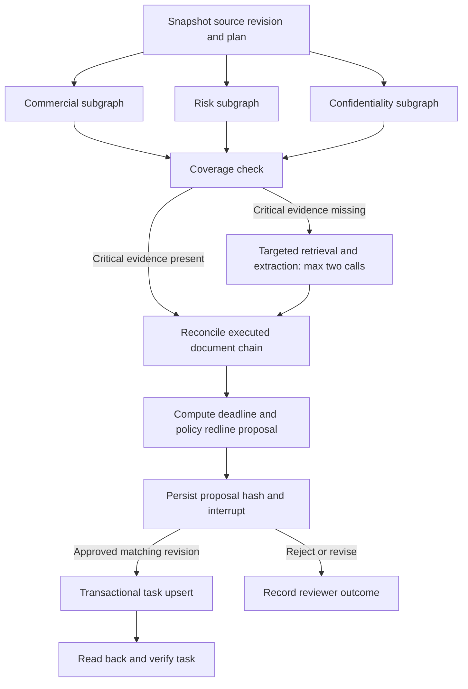

# Agent framework

## Graph

The three compiled subgraphs run in parallel. Each retrieves source chunks, calls the real structured model API and verifies its returned spans. The coverage route permits one recovery pass, with up to two calls for missing critical topics. A normal invocation uses four model calls; recovery increases this to at most six. Worker retries can repeat failed calls up to three attempts; graph checkpoints preserve completed supersteps.

## State and provenance

Matter revision, document IDs, exact character offsets, executed status, source ordinal, playbook snapshot, findings, rejected evidence, proposal hash, reviewer identity and task IDs are persisted. LangGraph stores its state in SQLite for a single local worker or PostgreSQL for deployment. Application tables independently enforce action authorization. The model's plan is advisory; mandatory branches always run.

## Input controls

Bearer authorization and tenant scoping apply to all business routes. Roles restrict writes. Upload sizes and text lengths are bounded. DOCX expansion is bounded. PDF scans fail explicitly instead of fabricating OCR. Document content is supplied as untrusted model data. The document parser does not run macros or execute content.

The initial deadline scope is explicit ISO renewal dates and numeric calendar-day notice periods. Business-day calculations, implied anniversaries and conditional renewal options need additional support; incomplete interpretations block task execution.

## Output controls

Every accepted finding must quote an exact substring and its value must occur inside that quote. This proves provenance, not semantic truth. Reviewers must confirm the action's cited findings. Executed documents require one root and a non-competing ancestry chain. Conflicting values from the same source block execution. Unsigned drafts do not override executed obligations.

Proposal hashes bind the revision, findings, issues, actions and redlines. Approval cannot execute against a changed revision. Worker lease checks fence database mutations. Task IDs are stable per tenant/matter/action kind; task upserts and audit events share a transaction. A second read verifies the stored plan hash and task state. All proposed DOCX edits remain subject to reviewer interpretation.

## Model and retrieval profiles

The local profile uses actual Ollama inference with Gemma 3 1B. It is a functional smoke-test model and is not adequate evidence of legal accuracy. The OpenAI-compatible provider accepts a configured endpoint, model and secret. Qwen is a candidate, not a measured performance claim.

Lexical BM25 is the tested CPU baseline. Optional hybrid retrieval combines BM25 and pinned BGE-M3 ranks with reciprocal-rank fusion, then reranks candidates with pinned BGE-reranker-v2-m3. The optional model path requires extra dependencies and is not included in the lightweight container or local accuracy results. Three implemented chunkers are clause, fixed and recursive; semantic chunking requests are rejected explicitly.

## Failure behavior

Unsupported evidence blocks approval. Stale sources cancel applicable execution. Model/network/schema errors trigger bounded worker retries and then a failed review. A persisted human interrupt resumes through a version-checked API decision. Review rejection and requested revision terminate with distinct statuses; new source input and a new review are needed to proceed.

No arbitrary shell tools, automatic emails, contract signatures or external issue writes are available to the model. Deployment-specific external integrations and semantic legal entailment verification remain future work, not hidden stubs presented as complete features.
